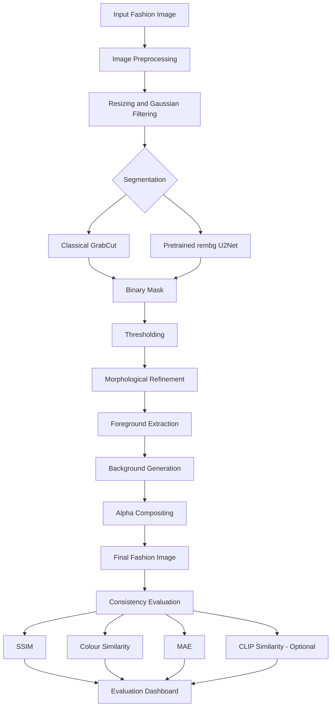

# FashionStudio AI – System Architecture

## Overall Pipeline

## Classical DIP Components

1. Image resizing.
2. Gaussian filtering.
3. Binary thresholding.
4. Erosion.
5. Dilation.
6. Opening.
7. Closing.
8. Contour detection.
9. Alpha compositing.
10. Image inpainting.

## AI Components

1. Pretrained U2Net segmentation through rembg.
2. Optional CLIP feature extraction.

## Evaluation

1. SSIM.
2. MAE.
3. Histogram similarity.
4. CIE Delta E 76.
5. IoU and Dice when ground-truth masks are available.
6. Runtime comparison.
